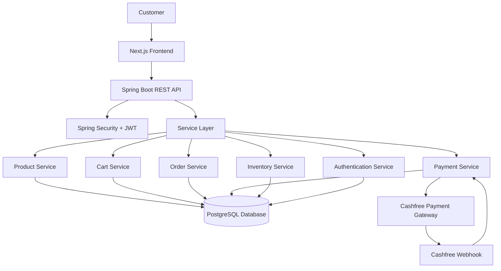
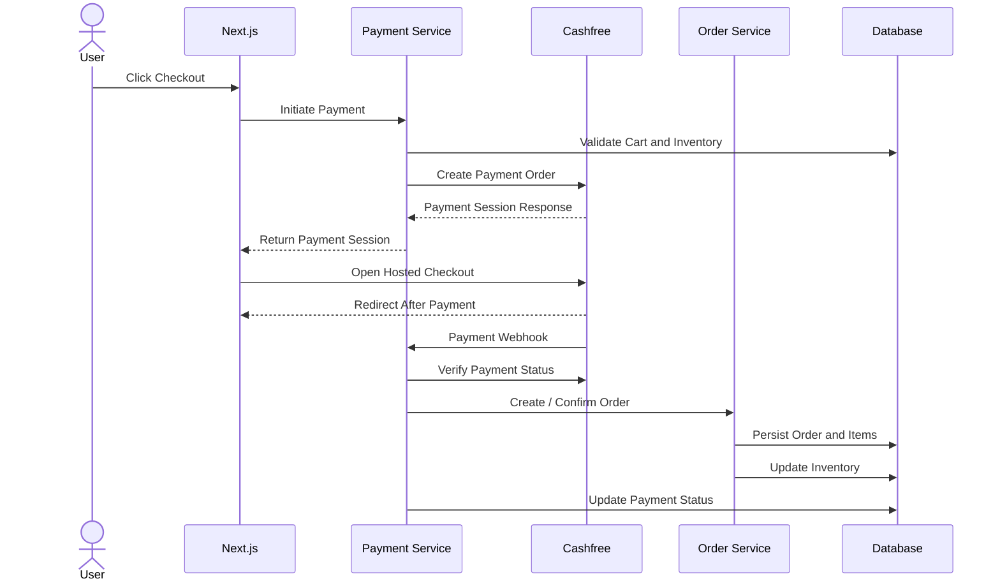

# ATELIER & CO. | Modern Full-Stack E-Commerce Platform

<p align="center">
  
  
  
  
  
</p>

<p align="center">
  A sophisticated, full-stack e-commerce application combining an elegant shopping experience with a secure, scalable backend architecture.
</p>

<p align="center">
  <strong>Discover. Shop. Experience.</strong>
</p>

---

## ✨ Overview

**ATELIER & CO.** is a modern full-stack e-commerce platform designed to deliver a seamless online shopping experience with a premium and responsive user interface.

Built with **Next.js, React, Tailwind CSS, Java, and Spring Boot**, the application combines a dynamic storefront with RESTful backend services, secure authentication, inventory management, shopping cart functionality, and payment gateway integration.

The project focuses on real-world e-commerce workflows, including guest shopping, authenticated user sessions, cart merging, product variants, order processing, and secure payment verification through Cashfree.

---

## 🚀 Key Features

### 🛍️ Modern Storefront

- Premium, clean, and responsive user interface.
- Editorial homepage with featured products, new arrivals, and best sellers.
- Dynamic product catalog powered by backend APIs.
- Product search, filtering, sorting, and pagination.
- Category-based product exploration.
- Product detail pages with image galleries.
- Product variant selection based on color, size, and storage.
- Dynamic pricing, MRP, and discount calculations.
- Stock-aware product selection and quantity controls.

### 🛒 Shopping Cart & Wishlist

- Add products to cart using product variant IDs.
- Dynamic quantity management.
- Real-time cart subtotal and total calculations.
- Discount and shipping calculations.
- Guest shopping cart support using a secure cookie-based token.
- Persistent cart for authenticated users.
- Automatic guest cart merging during login.
- Wishlist functionality with product management.
- Inventory-aware cart operations.

### 🔐 Authentication & Security

- User registration and login.
- JWT-based authentication.
- Spring Security integration.
- Role-based access control for customers and administrators.
- Secure password handling.
- Authenticated REST API endpoints.
- HTTP-only cookie support for guest cart identification.
- Protected customer-specific resources.

### 💳 Cashfree Payment Gateway Integration

Integrated with **Cashfree Payments** to support online payment processing.

- Cashfree payment order creation through the Spring Boot backend.
- Cashfree hosted checkout integration.
- Secure server-side payment initialization.
- Payment success and failure handling.
- Payment status verification.
- Backend payment verification before order confirmation.
- Cashfree webhook integration for payment event notifications.
- Payment and transaction status management.
- Test environment support for development.

The payment workflow is designed to avoid trusting frontend payment status alone.

### 📦 Product & Inventory Management

- Product catalog management.
- Category and brand associations.
- Product variants with SKU, color, size, and storage attributes.
- Product image management.
- Variant-level pricing.
- Inventory tracking.
- Stock availability checks.
- Stock-aware cart and order processing.
- Product detail retrieval using product slugs.

### 📋 Order Management

- Customer-specific order processing.
- Shipping address association.
- Order item snapshots for historical product information.
- Order status tracking.
- Payment status tracking.
- Order history.
- Payment transaction records.
- Order and inventory consistency considerations.

### 🎨 User Experience

- Responsive layouts for desktop, tablet, and mobile.
- Reusable UI components.
- Interactive product cards.
- Toast notifications.
- Loading, empty, and error states.
- Mobile-friendly navigation.
- Modern typography and consistent visual design.

---

## 🏗️ System Architecture

The application follows a frontend-backend architecture with REST APIs.



### Architecture Highlights

- Frontend and backend are independently structured.
- REST APIs enable communication between Next.js and Spring Boot.
- Business logic is separated into service layers.
- Spring Security protects authenticated endpoints.
- JWT is used for user authentication.
- JPA and Hibernate manage database persistence.
- Cashfree handles payment processing.
- Webhooks provide server-to-server payment event notifications.

---

## 💰 Payment Workflow

The application integrates Cashfree into the checkout process.



**Important:** The final order confirmation must depend on verified payment status, not only the redirect URL or frontend response. Payment verification and order creation should also be designed to handle duplicate webhook events idempotently.

---

## 🧰 Tech Stack

### Frontend

| Technology | Purpose |
|---|---|
| Next.js | React framework and application routing |
| React | Component-based UI development |
| JavaScript | Frontend logic |
| Tailwind CSS | Responsive styling |
| Axios | REST API communication |
| React Context API | Global state management |
| Lucide React | Icons |

### Backend

| Technology | Purpose |
|---|---|
| Java | Backend programming language |
| Spring Boot | Backend application framework |
| Spring Web | REST API development |
| Spring Security | Authentication and authorization |
| JWT | Token-based authentication |
| Spring Data JPA | Database access and repositories |
| Hibernate | ORM and persistence management |
| Maven | Dependency management and build automation |
| Bean Validation | Request validation |

### Database & Payments

| Technology | Purpose |
|---|---|
| PostgreSQL | Relational database |
| Supabase | PostgreSQL database hosting |
| Cashfree Payments | Payment gateway integration |
| Cashfree Webhooks | Server-to-server payment notifications |

### Development Tools

- Git & GitHub
- IntelliJ IDEA
- VS Code
- Postman
- Maven
- Browser Developer Tools

---

## 📂 Project Structure

### Frontend

```text
frontend/
├── src/
│   ├── app/
│   │   ├── page.jsx
│   │   ├── layout.jsx
│   │   ├── globals.css
│   │   ├── products/
│   │   │   ├── page.jsx
│   │   │   └── [slug]/
│   │   │       └── page.jsx
│   │   ├── categories/
│   │   │   └── [slug]/
│   │   │       └── page.jsx
│   │   ├── cart/
│   │   │   └── page.jsx
│   │   ├── wishlist/
│   │   │   └── page.jsx
│   │   ├── checkout/
│   │   │   └── page.jsx
│   │   ├── login/
│   │   │   └── page.jsx
│   │   ├── register/
│   │   │   └── page.jsx
│   │   └── account/
│   │       └── page.jsx
│   │
│   ├── components/
│   │   ├── layout/
│   │   ├── home/
│   │   ├── products/
│   │   ├── cart/
│   │   ├── dashboard/
│   │   └── ui/
│   │
│   ├── context/
│   │   ├── AuthContext.jsx
│   │   ├── CartContext.jsx
│   │   ├── WishlistContext.jsx
│   │   └── NotificationContext.jsx
│   │
│   ├── hooks/
│   ├── utils/
│   └── lib/
│
├── public/
├── package.json
└── README.md
```

### Backend

```text
backend/
├── src/
│   ├── main/
│   │   ├── java/
│   │   │   └── com/
│   │   │       └── ecommerce/
│   │   │           └── application/
│   │   │               ├── config/
│   │   │               ├── controller/
│   │   │               ├── dto/
│   │   │               ├── entity/
│   │   │               ├── repository/
│   │   │               ├── service/
│   │   │               ├── security/
│   │   │               ├── exception/
│   │   │               └── util/
│   │   │
│   │   └── resources/
│   │       └── application.properties
│   │
│   ├── test/
│   │
│   └── pom.xml
│
└── .env
```

*The directory structure is a representative overview; adapt it to the actual folders in your repository.*

---

## ⚙️ Getting Started

### Prerequisites

Make sure you have the following installed:

- Java JDK
- Maven
- Node.js and npm
- PostgreSQL database or Supabase project
- Cashfree developer account for payment testing

### 1. Clone the Repository

```bash
git clone https://github.com/YOUR_USERNAME/YOUR_REPOSITORY.git
```

```bash
cd YOUR_REPOSITORY
```

### 2. Setup Backend

Navigate to the backend directory.

```bash
cd backend
```

Configure your environment variables.

Create a `.env` file or configure the variables using your preferred environment configuration method.

```env
# Database
DB_URL=jdbc:postgresql://YOUR_HOST:5432/YOUR_DATABASE
DB_USERNAME=YOUR_DATABASE_USERNAME
DB_PASSWORD=YOUR_DATABASE_PASSWORD

# JWT
JWT_SECRET=YOUR_SECURE_JWT_SECRET

# Cashfree
CASHFREE_CLIENT_ID=YOUR_CASHFREE_CLIENT_ID
CASHFREE_CLIENT_SECRET=YOUR_CASHFREE_CLIENT_SECRET
CASHFREE_ENV=SANDBOX

# Frontend
FRONTEND_URL=http://localhost:3000
```

*These are example variable names. Match them with the names used in your Spring Boot configuration.*

Run the backend:

```bash
./mvnw spring-boot:run
```

On Windows:

```bash
mvnw.cmd spring-boot:run
```

### 3. Setup Frontend

Navigate to the frontend directory.

```bash
cd frontend
```

Install dependencies.

```bash
npm install
```

Create a `.env.local` file.

```env
NEXT_PUBLIC_API_URL=http://localhost:8080/api
```

Start the development server.

```bash
npm run dev
```

Open the application:

```text
http://localhost:3000
```

### 4. Build for Production

Frontend:

```bash
npm run build
npm start
```

Backend:

```bash
./mvnw clean package
```

---

## 🔌 API Integration

The frontend communicates with the Spring Boot backend through REST APIs.

| Module | API Functionality |
|---|---|
| Authentication | Registration, login, JWT authentication |
| Products | Product listing, detail by slug, pagination |
| Categories | Category listing and product filtering |
| Cart | Add items, update quantities, retrieve cart |
| Wishlist | Manage saved products |
| Address | Manage customer shipping addresses |
| Orders | Create and retrieve customer orders |
| Payments | Cashfree payment initialization and verification |
| Webhooks | Cashfree payment event handling |
| Inventory | Stock availability and quantity management |

Example authentication endpoint:

```http
POST /api/auth/user/login
```

Example product retrieval:

```http
GET /api/public/products
```

Example cart operation:

```http
POST /api/cart/addToCart
```

*Exact endpoint paths depend on the controller mappings configured in the backend.*

---

## 🔒 Security Considerations

Security is an important part of this project.

- JWT-based authentication for protected API access.
- Role-based authorization using Spring Security.
- Passwords are stored using secure password hashing.
- Sensitive payment credentials are kept on the backend.
- Cashfree payment status is verified server-side.
- Webhook requests must be validated using Cashfree's signature verification mechanism.
- HTTP-only cookies are used where applicable.
- Environment variables are used for secrets and configuration.
- Customer-specific resources are accessed with ownership checks.

Never commit `.env`, JWT secrets, database credentials, or Cashfree client secrets to GitHub.

---

## 🌱 Future Enhancements

- Product reviews and ratings.
- Advanced recommendation system.
- Coupon and discount management.
- Advanced admin analytics dashboard.
- Email notifications for orders and payments.
- Order tracking and shipment integration.
- Automated backend testing.
- CI/CD deployment pipeline.
- Enhanced observability and logging.
- Redis caching for frequently accessed data.

---

## 🎯 Learning Objectives

This project demonstrates practical implementation of:

- Full-stack web application development.
- RESTful API design using Spring Boot.
- JWT authentication and role-based access control.
- Relational database design and ORM.
- E-commerce product and variant modeling.
- Guest and authenticated shopping cart workflows.
- Payment gateway integration.
- Webhook-based event processing.
- Frontend and backend integration.
- Secure checkout and order processing.

---

## 👨‍💻 Developer

**Ayush Jha**

Electronics Engineering Student | Full-Stack Developer

Interested in Java, Spring Boot, React, Next.js, Data Structures & Algorithms, and scalable web application development.

---

## ⭐ Support

If you find this project interesting, consider giving the repository a ⭐ on GitHub.

<p align="center">
  <strong>ATELIER & CO.</strong><br/>
  Crafted for a modern shopping experience.
</p>
